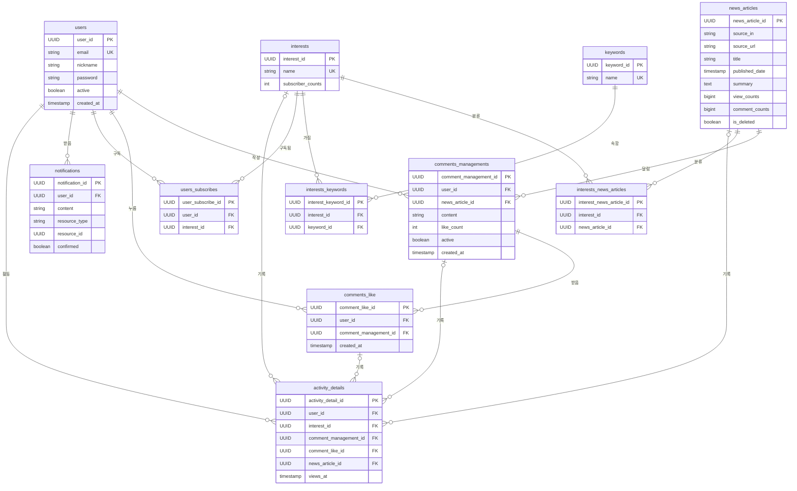

<h2>Monew</h2>

여러 뉴스 API를 통합하여 사용자에게 맞춤형 뉴스를 제공하고 의견을 나눌 수 있는 소셜 기능을 갖춘 서비스

> 서버 상태 : 팀 프로젝트 기간에 AWS ECS 로 배포했던 서버는 팀 프로젝트 종료 후 내려감. 지금 접속할 수 있는 배포 서버는 없음

## 개요
- 프로젝트 이름: Monew 🏠
- 팀 프로젝트 기간: 2025.05 - 2025.06 (5명) · 이후 개선 기간: 2025.07 - 2026.10
- 원래 팀 저장소: [sb02-monew-team05](https://github.com/sb02-monew-team05/sb02-monew-team05) 여기서 분리해 혼자 이어서 작업한 저장소입니다
- 팀 멤버: 김세은, 김지협, 심민혁, 양진호, 양찬혁

## 왜 만들었나
- 수강 과정 팀 프로젝트로 만든 뉴스 서비스를, 팀 프로젝트가 끝난 뒤 혼자 이어서 개선
- 이 서비스에서 가장 많이 불리는 API를 기사를 열면 따라오는 댓글 페이지 조회라는 가정을 세움
- 인기 기사일수록 같은 데이터를 여러 사람이 동시에 요청함
- 이 API 가 어디까지 받을 수 있고 무엇이 먼저 막히는지 직접 재보려고 시작
- 2025.07 1차 개선은 측정 근거가 흩어져 남지 않아, 2026.09 에 정확성부터 고치고 다시 측정

## 핵심 문제와 결과

1. 캐시가 틀린 응답을 주던 결함 수정
   - 측정 전에 조회 결과가 틀리던 결함 4건 수정, 캐시 무효화 새로 추가
   - 남의 좋아요 상태가 보이던 것, 쓰기 뒤 최대 1분간 옛 목록이 나가던 것 등
   - PR : [#1](https://github.com/QuokkaJoa/monew_advanced/pull/1) · [#2](https://github.com/QuokkaJoa/monew_advanced/pull/2) · [#4](https://github.com/QuokkaJoa/monew_advanced/pull/4)
   - 블로그 : [캐시가 틀린 답을 주고 있었다](https://velog.io/@quokkajoa/캐시가-틀린-답을-주고-있었다)
2. 막히는 곳을 단계별로 찾아 처리량 개선
   - 초당 20건대에서 무너지던 조회를 인덱스(1,200건) → 캐시(1,600건) → 앱 2대(3,200건) 순으로 개선
   - 단계마다 DB 와 앱 CPU 를 같이 보고 다음 처방 결정. 병목은 DB 에서 앱으로 이동
   - PR : [#6](https://github.com/QuokkaJoa/monew_advanced/pull/6) · [#10](https://github.com/QuokkaJoa/monew_advanced/pull/10) · [#11](https://github.com/QuokkaJoa/monew_advanced/pull/11)
   - 블로그 : [어디서 막히는지 단계별로 재기](https://velog.io/@quokkajoa/어디서-막히는지-단계별로-재기)
3. 분산 락 재측정 후 기본값 끔
   - 2025년 2인 리팩터링에서 함께 넣은 분산 락을 2026년에 다시 측정
   - 쓰기를 섞으면 캐시 재생성 4.3% 감소, 대신 최대 응답 1.9배, 실패 0건 → 33건(97만 건 중)
   - 측정 재현을 위해 코드는 남기고 `CACHE_LOCK_ENABLED` 로 켤 수 있게 둠
   - 블로그 : [분산 락을 넣었다가 끈 이유](https://velog.io/@quokkajoa/분산-락을-넣었다가-끈-이유)

- Wiki : [Monew Wiki](https://github.com/QuokkaJoa/monew_advanced/wiki)

## 기술 스택

          

| 분류 | 사용 |
|---|---|
| 언어·프레임워크 | Java 17, Spring Boot 3.5.0, Spring Data JPA, QueryDSL 5.0, Spring Batch |
| DB | PostgreSQL 15 (로컬 Docker), PostgreSQL 18.3 (측정용 AWS RDS), H2 (테스트) |
| 캐시·락 | Redis 7.0 (로컬 Docker), Valkey 7.2 (측정용 AWS ElastiCache), Redisson 3.20.0 |
| 뉴스 수집·백업 | 네이버 뉴스 API, 언론사 RSS (Rome), AWS S3 |
| 측정·모니터링 | k6, Prometheus, Grafana, JFR, CloudWatch |
| 측정 인프라 | AWS EC2, ALB, RDS, ElastiCache (2026-10-01 삭제) |
| 빌드·테스트 | Gradle, Docker, GitHub Actions (테스트), Testcontainers, JaCoCo |

## 시스템 아키텍처
- 팀 프로젝트 기간(2025)의 배포 구조. 성능 측정 환경은 아래 [측정 조건](#측정-조건) 참고

## ERD

성능 측정 중 추가한 인덱스
- `idx_comments_article_created` : comments_managements (news_article_id, created_at, comment_management_id), 활성 댓글만 (`WHERE active = TRUE`)
- `idx_comments_like_user_comment` : comments_like (user_id, comment_management_id)

## 작업 히스토리

팀 프로젝트가 끝난 뒤 지속적인 리팩터링을 진행하였습니다.

2025.05 ~ 06 - 팀 5명 : 기능 구현

2025.07 - 2명 (1차 리팩터링) :
1. 인기 기사 1개 댓글 조회의 트래픽이 폭발한다는 가정을 두고 성능 테스트를 진행
2. 나와 팀원 1명이 k6로 병목 상황을 만들어 각 구간마다 인덱스, 캐시, 분산락을 통해 병목 해결
3. 병목은 개선되었으나 측정 과정에서 명확한 개선 이유를 찾지 못해 헤맸고 측정 원본도 흩어짐

2025.12 - 단독 :
1. 캐시와 락을 거는 코드가 서비스 로직에 뒤섞여 있었음
2. 어디서 캐시가 걸리는지 읽어서 알 수 없는 상태라 어노테이션과 AOP 로 분리하고 테스트를 붙임

2026.09 ~ 10 - 단독 (2차 리팩터링) :
1. 1차 리팩터링에 대한 증거가 부족하다고 판단되어 성능 테스트를 다시 진행하기로 결정
2. 1차에서 넣은 캐시가 조회 결과를 틀리게 만들고 있음을 확인
3. 틀린 코드를 재면 틀린 값이 나오므로 정확성을 먼저 고치고, 그다음 구간을 나눠 다시 측정
4. 정확성 수정과 재측정 과정은 위 [핵심 문제와 결과](#핵심-문제와-결과)와 블로그에 정리

## 측정 조건

- 측정은 배포 서버와 별도로 꾸린 AWS 환경(EC2, ALB, RDS, ElastiCache)에서 진행
- 이 환경은 2026-10-01 측정을 마치고 삭제
- 고른 이유의 자세한 근거 : [Wiki 성능 테스트](https://github.com/QuokkaJoa/monew_advanced/wiki/%EC%84%B1%EB%8A%A5-%ED%85%8C%EC%8A%A4%ED%8A%B8#고른-이유)

### 앱 : EC2 c6g.large 1~2대
- 측정마다 CPU 세대가 바뀌지 않도록 ECS·Fargate 대신 EC2 를 직접 씀

### DB : RDS db.r6g.large PostgreSQL 18.3
- 인덱스 효과가 디스크 속도와 섞이지 않도록 데이터가 전부 메모리에 들어가는 등급을 고름
- 측정 중 디스크를 읽지 않은 것을 실행계획으로 확인

### 캐시 : ElastiCache cache.t4g.medium
- 담는 양이 작아 메모리가 아니라 계속 낼 수 있는 네트워크 대역폭으로 고름
- 측정 중 대역폭 제한에 걸리지 않은 것을 확인

### 부하 : 별도 EC2 c6g.xlarge
- 부하를 주는 쪽이 먼저 막히지 않도록 앱보다 큰 서버를 씀

### JVM 힙 : `-Xms2g -Xmx2g`
- GC 멈춤이 응답 시간에 섞이지 않도록 힙을 넉넉히 고정하고, 모든 구간에 같은 값을 씀

## API 문서

springdoc-openapi 사용

### 백업 관리
-   `POST /api/backup/restore`  - 백업 복원

### 사용자 관리
-   `POST /api/users`  - 회원가입
-   `POST /api/users/login`  - 로그인
-   `PATCH /api/users/{userId}`  - 프로필 수정
-   `DELETE /api/users/{userId}`  - 회원탈퇴

### 뉴스 기사
-   `GET /api/articles`  - 기사 목록 조회
-   `POST /api/articles/{articleId}/article-views`  - 조회수 증가
-   `GET /api/articles/sources`  - 뉴스 소스 목록
-   `GET /api/articles/restore`  - 데이터 복원

### 댓글 시스템

-   `GET /api/comments`  - 댓글 목록
-   `POST /api/comments`  - 댓글 작성
-   `POST /api/comments/{commentId}/comment-likes`  - 댓글 좋아요

### 관심사 관리

-   `POST /api/interests`  - 관심사 등록
-   `GET /api/interests`  - 관심사 검색
-   `POST /api/interests/{interestId}/subscriptions`  - 구독

### 알림

-   `GET /api/notifications`  - 알림 목록
-   `PATCH /api/notifications`  - 알림 읽음 처리

### 사용자 통계

-   `GET /api/user-activities/{userId}`  - 활동 통계

## 프로젝트 설치 방법
1. git clone https://github.com/QuokkaJoa/monew_advanced.git
2. 환경 변수 파일 만들기
3. docker compose up -d
